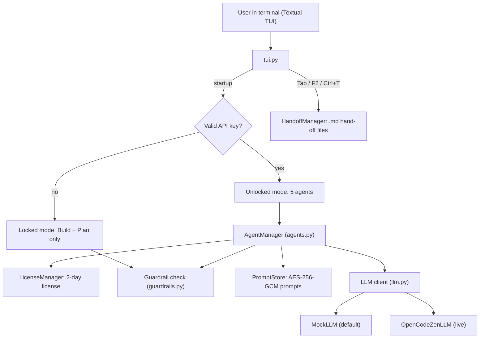
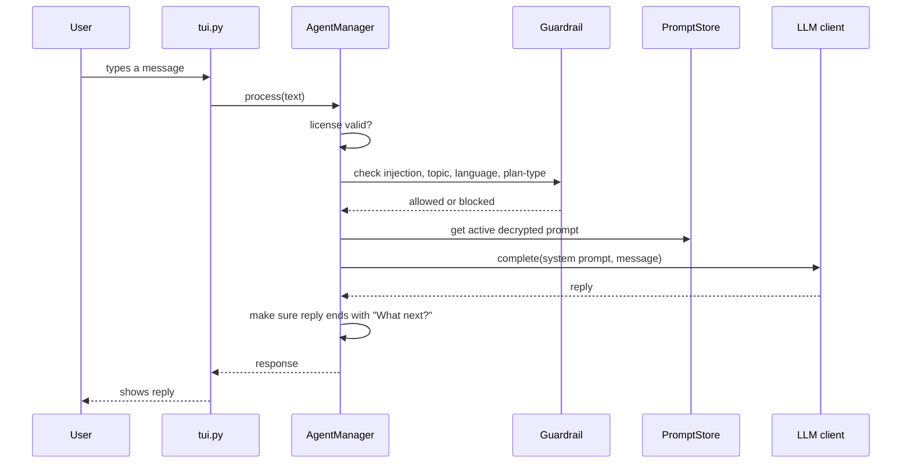

# GameCode

A locked-down 5-agent C++/C# coding assistant for Windows, built with Python and Textual.
Prompts are encrypted at rest, requests pass through layered guardrails, a valid API key
unlocks the full pipeline, and the license expires 2 days after first run.

## Architecture



## Request flow



## The five agents

| Agent | Name | Language scope | Can edit files |
|-------|------|----------------|----------------|
| Agent1 | C++ Orchestrator | C++ | No (plan-type) |
| Agent2 | C# Architect | C# | Yes |
| Agent3 | C++ Reviewer | C++ | No (plan-type) |
| Agent4 | C# Debugger | C# | Yes |
| Agent5 | Systems Engineer | C++ and C# | Yes |

Each agent has its own system prompt and a subagent prompt (Agent1a to Agent5a).
Press Tab, F2 or Ctrl+T to move to the next agent. Every switch writes a numbered
`.md` hand-off file with the conversation so far.

## Security design

- **Prompts at rest:** AES-256-GCM, with a key derived from the API key using
  PBKDF2-HMAC-SHA256 (200,000 iterations). Each file gets a fresh salt and nonce.
  Tampered or wrong-key data fails authentication.
- **Prompts in memory:** only the active agent's prompt is decrypted. Switching
  agents clears the old one before loading the next.
- **Guardrails:** prompt-injection defense (typos, leetspeak, look-alike letters,
  base64/hex, role-change phrases, chat-template tokens), off-topic block,
  per-agent language scope, plan-type no-edit, and "What next?" enforced in code.
- **API key gate:** no valid key means Locked Mode (Build and Plan placeholders
  only; no custom prompts or pipeline).
- **License:** stored encrypted, valid for 2 days after first run. When it
  expires, every agent is disabled, including Locked Mode.

## Install (Windows)

Run `GameCode-Setup.exe`. The wizard has an API key page; leave it blank to start in
Locked Mode. Uninstalling removes the app and its data folder.

## Run from source

```powershell
python -m venv .venv
.venv\Scripts\activate
pip install -r requirements.txt
python run_gamecode.py
```

| Variable | Purpose |
|----------|---------|
| `GAMECODE_API_KEY` | Key that unlocks the 5-agent pipeline |
| `GAMECODE_USE_LIVE_LLM` | Set to `1` to call OpenCode Zen instead of the mock |
| `GAMECODE_HOME` | Override the data folder (default `%APPDATA%\GameCode`) |
| `GROQ_API_KEY` | With the live flag on, gives each agent its own Groq model |
| `OPENCODE_ZEN_MODEL` | Override the Zen model name |

A key is accepted if it starts with `sk-` or `oc_sk_` and is at least 20 characters.

## Tests

```powershell
pytest
```

## Build the installer

```powershell
.\installer\build_exe.ps1
& "C:\Program Files (x86)\Inno Setup 6\ISCC.exe" installer\GameCode.iss
```

Output: `installer_output\GameCode-Setup.exe`.

## Known limitations
- With `GAMECODE_USE_LIVE_LLM=1` and a `GROQ_API_KEY`, each agent uses its own
  Groq model. Without them, a deterministic mock keeps the pipeline working offline.
  `OpenCodeZenLLM` targets `https://opencode.ai/zen/v1`; the key authenticated, but
  Zen's free usage limit blocked live replies during testing.
- Subagent prompts are stored encrypted, but subagents are not yet called by the pipeline.
- The API key is checked for format only, not against a server.
- `config.json` holds the key in plain text; production should use Windows DPAPI.
- The license is a local file. A different key or a deleted license file starts a fresh
  license, so production would need a server-side check.
- OpenCode fork, model anonymization, MCP servers and skills are deferred.

## Documentation

- [Compliance matrix](docs/COMPLIANCE.md)
- [Architecture](docs/ARCHITECTURE.md)
- [Demo script](docs/DEMO_SCRIPT.md)