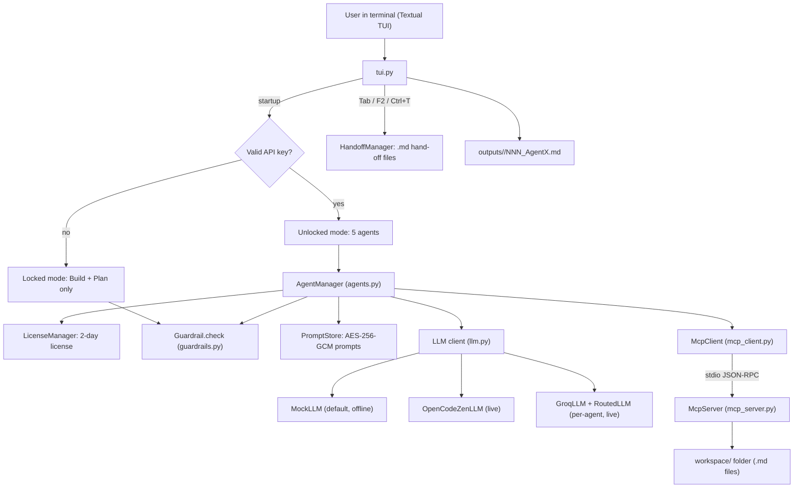
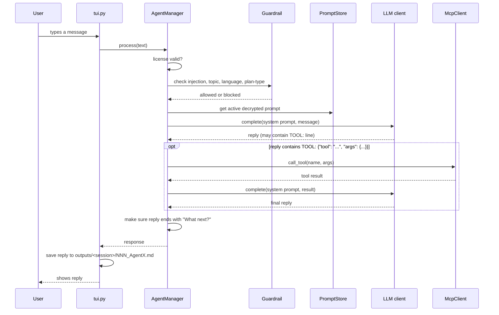

# GameCode

A standalone Windows terminal app (Python + Textual) with a 5-agent pipeline for
C++ and C# work. Agents are locked down by encryption, guardrails, an API key
gate and a license expiry.

Built for the Infotainment Academy **AI/Prompt Engineer** test task.

## Architecture



## Request flow



## The five agents

| Agent | Name | Language scope | Can edit files | Subagent |
|-------|------|----------------|----------------|----------|
| Agent1 | C++ Orchestrator | C++ | No (plan-type) | Agent1a |
| Agent2 | C# Architect | C# | Yes | Agent2a |
| Agent3 | C++ Reviewer | C++ | No (plan-type) | Agent3a |
| Agent4 | C# Debugger | C# | Yes | Agent4a |
| Agent5 | Systems Engineer | C++ and C# | Yes | Agent5a |

Each agent has its own system prompt and a subagent prompt (Agent1a to Agent5a).
Press Tab, F2 or Ctrl+T to move to the next agent. Every switch writes a numbered
`.md` hand-off file with the conversation so far. Every allowed reply is also
saved as a numbered `.md` file in `outputs/<session>/`.

## MCP tool-calling

Agents can call a bundled MCP stdio server through a strict `TOOL:` protocol.
The server (`mcp_server.py`) exposes three tools on a `workspace/` folder:

- `list_outputs` — list `.md` files in the workspace (read-only)
- `read_output` — read one `.md` file by name (read-only)
- `write_markdown` — write a `.md` file into the workspace

Plan-type agents (Agent1, Agent3) receive only the read-only tools. Build-type
agents (Agent2, Agent4, Agent5) receive all three. This preserves the "plan
agents never edit files" rule at the tool layer, not just in prose.

The client (`mcp_client.py`) launches the server as a subprocess (over stdio,
JSON-RPC 2.0), performs the `initialize` handshake, lists tools, and calls them
with a timeout. The installed `.exe` launches itself with `--mcp-server` to act
as the server, so no external Python or Node runtime is needed.

Live-verified: Agent5 saved `plan.md` into the workspace via a real Groq-driven
`TOOL:` call. Covered by `tests/test_agent_tools.py`, `tests/test_mcp_client.py`
and `tests/test_mcp_server.py`.

## Skills

`skills/mcp-builder/SKILL.md` is loaded from disk (and bundled in the `.exe`).
Agent system prompts include a short reference-only list of available skills so
the model can draw on them. Skills never override guardrails or language scope.
Source credited in `THIRD_PARTY_NOTICES.md`.

## Security design

- **Prompts at rest:** AES-256-GCM, with a key derived from the API key using
  PBKDF2-HMAC-SHA256 (200,000 iterations). Each file gets a fresh salt and nonce.
  Tampered or wrong-key data fails authentication.
- **Prompts in memory:** only the active agent's prompt is decrypted. Switching
  agents clears the old one before loading the next.
- **Guardrails:** prompt-injection defense (typos, leetspeak, look-alike letters,
  base64/hex, role-change phrases, chat-template tokens), off-topic block,
  per-agent language scope, plan-type no-edit, and "What next?" enforced in code.
- **API key gate:** no valid key means Locked Mode (Build and Plan placeholders
  only; no custom prompts or pipeline).
- **License:** stored encrypted, valid for 2 days after first run. When it
  expires, every agent is disabled, including Locked Mode.

## Install (Windows)

Run `GameCode-Setup.exe`. The wizard has an API key page; leave it blank to start in
Locked Mode. Uninstalling removes the app and its data folder
(`%APPDATA%\GameCode`).

## Run from source

```powershell
python -m venv .venv
.venv\Scripts\activate
pip install -r requirements.txt
python run_gamecode.py
```

| Variable | Purpose |
|----------|---------|
| `GAMECODE_API_KEY` | Key that unlocks the 5-agent pipeline |
| `GAMECODE_USE_LIVE_LLM` | Set to `1` to call a real model instead of the mock |
| `GAMECODE_HOME` | Override the data folder (default `%APPDATA%\GameCode`) |
| `GROQ_API_KEY` | With the live flag on, gives each agent its own Groq model |
| `OPENCODE_ZEN_MODEL` | Override the Zen model name |
| `GAMECODE_LICENSE_DAYS` | Override the 2-day license (useful for testing expiry) |
| `GAMECODE_WORKSPACE` | Override the MCP workspace folder |

A key is accepted if it starts with `sk-` or `oc_sk_` and is at least 20 characters.

## Tests

```powershell
pytest
```

170 tests: cipher, license, prompt store, guardrails (typos, leet, homoglyph,
encoding, role change, sentinels, per-agent scope, plan-type), agents, hand-off
files, TUI (locked + unlocked), config, LLM (Mock + Zen + Groq + Routed),
MCP server + client + agent tool-calling, skills loader, skills integration.

## Build the installer

```powershell
.\installer\build_exe.ps1
& "C:\Program Files\Inno Setup 7\ISCC.exe" installer\GameCode.iss
```

(Adjust the Inno Setup path if it is installed under `Program Files (x86)`.)

Output: `installer_output\GameCode-Setup.exe`.

## Known limitations

- With `GAMECODE_USE_LIVE_LLM=1` and a `GROQ_API_KEY`, each agent uses its own
  Groq model. Without them, a deterministic mock keeps the pipeline working offline.
  `OpenCodeZenLLM` targets `https://opencode.ai/zen/v1`; the key authenticated, but
  Zen's free usage limit blocked live replies during testing. Groq was used as the
  outside-provider model for the live demo.
- Subagent prompts are stored encrypted, but subagents are not yet called by the
  pipeline automatically.
- The API key is checked for format only, not against a server.
- `config.json` holds the key in plain text; production should use Windows DPAPI.
- The license is a local file. A different key or a deleted license file starts a
  fresh license, so production would need a server-side check.
- MCP tool-calling relies on the model emitting the required `TOOL:` line. With
  few-shot examples in the system prompt, free Groq models follow it reliably;
  smaller or stricter models may need further prompt tuning.
- OpenCode fork and model-name visibility: not done (see `COMPLIANCE.md`).

## Documentation

- [Compliance matrix](docs/COMPLIANCE.md)
- [Architecture](docs/ARCHITECTURE.md)
- [Demo script](docs/DEMO_SCRIPT.md)

- Video Resources
https://drive.google.com/drive/folders/1O4ntC_C2qOtg7Rr0IdaUpkANOmSp0mZt?usp=sharing